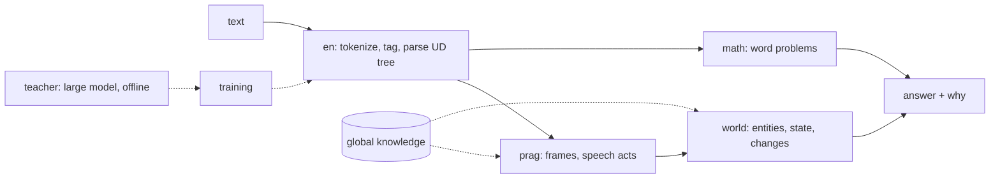

# Mova

**A small, transparent, deterministic language model in Rust: it parses and reasons instead of guessing tokens.**

[](LICENSE.md)
[](licence/DATA.md)
[](https://www.rust-lang.org/)
[](CHANGELOG.md)
[](https://github.com/ElamurAI/mova-free/actions/workflows/ci.yml)

[Quick start](#quick-start) · [Measured](#measured) · [Architecture](docs/architecture.md) · [Limits](#limits)

Mova is a small, transparent language model written in Rust. English comes first.

Mova does not predict the next token. It reads text the way a linguist would:

- it builds a **Universal Dependencies tree** for each sentence;
- it reads the tree into **frames**: who did what to whom, where, why, and what happened next;
- it keeps a **world** of the text: who is there, who has what, and what changed;
- it answers from that world.

Story → question → answer → why, on a bAbI-style story (real output, 2026-10-16; the state line on stderr is left out; the model is found in `$MOVA_DATA`, see [Quick start](#quick-start)):

```sh
target/release/world babi-probe "Mary went to the kitchen." "Mary picked up the apple." "Mary went to the garden." "Where is the apple?"
```

```text
Mary went to the kitchen. → None
Mary picked up the apple. → None
Mary went to the garden. → None
? Where is the apple? → ("garden", "apple in mary")
```

`None` after a sentence means it was read with no gap. The answer is `garden`, and the reason is `apple in mary`: Mary holds the apple, so the apple is where Mary is. When the answer needs knowledge, the reason names it:

```text
Sumit is tired. → None
? Where will sumit go? → ("bedroom", "tired → bedroom (level 1)")
```

Every step is deterministic, and every decision can say *why*: which rule, which feature, which piece of knowledge.

## Quick start

Get the code, fetch the model, build:

```sh
git clone https://github.com/ElamurAI/mova-free.git
cd mova-free
export MOVA_DATA=~/mova-data     # the data directory: models, corpora, runs
./install.sh
cargo build --release
```

- `./install.sh` downloads the trained model `en.bin` for release 0.4 from `https://research.elamur.ai/download/0/0.4/`, checks its SHA-256 and puts it at `$MOVA_DATA/en/models/en.bin`. Models and corpora live outside the repo, in the **data directory** `$MOVA_DATA` (default `~/mova-data`): `MOVA_DATA=/srv/mova ./install.sh` puts it elsewhere, and `MOVA_MODELS_URL=<base url>` picks another mirror. It needs `curl` and `sha256sum`; running it again leaves an up-to-date model alone.
- `cargo build --release` at the root builds the workspace (a recent stable Rust, edition 2024; developed with 1.99); the binaries are in `target/release/`.

In the examples below, lines starting with `#` under a command show its output.

Parse a sentence:

```sh
echo "The cat sat on the mat because it was tired." > s.txt
target/release/en annotate $MOVA_DATA/en/models/en.bin s.txt          # CoNLL-U
```

Read pragmatics off a text:

```sh
target/release/prag infer $MOVA_DATA/en/models/en.bin "Some of the guests left early. Oh great, another meeting."
#   scalar implicature [Some]: not «all» … (Quantity)
#   irony candidate (score 3) [explicit incongruity, oh great] …
```

Answer a question about a short story from its world:

```sh
target/release/world babi-probe "Mary went to the kitchen." "Mary picked up the apple." "Where is the apple?"
#   ? Where is the apple? → ("kitchen", "apple in mary")
```

Solve a word problem through the tree:

```sh
target/release/world treeread "Tom has 5 apples. He buys 3 more apples. How many apples does Tom have now?"
#   Some((8, "left: 5 + 3 (buy)"))
```

Run a primary-school course: the pupil reads each lesson, practises on its exercises, then sits the tests and the exam.

```sh
target/release/world knowledge course biology
```

### Two execution modes

Mova always has two modes ([docs/gpu-exec.md](docs/gpu-exec.md)):

- **CPU only** is the default. It needs no CUDA, it is exact, and it is the reference for every measured claim.
- **GPU enhanced** is built with `cargo build --release -p world --features gpu` and turned on at run time with `MOVA_EXEC=gpu`. Batch stages run on the GPU. Each stage is either exact (byte-identical to the CPU) or an *approximant*, whose agreement with the CPU is measured and published.

Asking for the GPU from a CPU-only build is an error, not a silent fallback.

## Licences

| what | licence | where |
|---|---|---|
| code of this repository | Elamur Cosmic License (a draft, not yet reviewed by a lawyer): free to use and modify by anyone, but not for mass surveillance, political repression or censorship (section 2) | [LICENSE.md](LICENSE.md), [licence/](licence) |
| trained model `en.bin` | CC BY-SA 4.0, as the UD English treebanks it is trained on | downloaded by [`install.sh`](install.sh), not in git |
| corpus 0.4 | CC BY-SA 4.0 | <https://research.elamur.ai/corpus/0.4/>, described in [corpus/open/](corpus/open/) |
| third-party data | its own terms | [licence/DATA.md](licence/DATA.md) |

Details are in [Data and licences](#data-and-licences) below.

## How it works



A large model is used only as a **teacher**. It writes lessons, checks parses and labels silver data, offline. It never answers at test time: every score Mova reports is Mova's own. The full map is in [docs/architecture.md](docs/architecture.md).

Mova has **three levels of logic** ([docs/design-three-levels.md](docs/design-three-levels.md)):

1. **Global**: compiled knowledge, such as concepts, verb classes, relations (inverse, direction, transitivity, time order) and values. It is written as short markdown *seeds* that `build.rs` compiles into Rust tables, so a rule is an integer comparison, not a string match.
2. **Domain modules**: English grammar and parsing, mathematics, pragmatics, coreference, story worlds, the schools.
3. **Temporary context**: the world of the current text. It never invents knowledge. Every conclusion goes through the global level, and a missing link is reported as a gap, which becomes the next thing to learn.

Mova also **retrains itself** ([docs/selfplay.md](docs/selfplay.md), [docs/induce.md](docs/induce.md)). It induces repair rules from its own parses, proposes cheap changes of its rules and settings, tests them on held-out data, and logs every positive and negative experiment in a journal it reads before the next one. It never changes its shipped rules without a gate.

## What it does

| area | what you get | where |
|---|---|---|
| English UD | tokenizer, tagger, transition parser, morphology and lemmas, trained like a model but without neural nets; CoNLL-U in and out | [`en`](en) |
| GPU parser | the same trees from a transformer trained from scratch on the GPU, more accurate on school text | [`gparse`](gparse) |
| pragmatics | frames (agent, patient, recipient, place, cause, next), speech acts, implicatures, irony candidates, idioms read by their real meaning | [`prag`](prag), [docs/pragmatics.md](docs/pragmatics.md) |
| knowledge | compiled common sense: verb classes, measures, values as principles, the absurdity matrix (how plausible an event is) | [`global`](global), [docs/absurdity.md](docs/absurdity.md) |
| worlds and schools | a pupil that lives through primary-school courses (26 992 test questions) and a maths student for word problems | [`world`](world), [docs/school-making.md](docs/school-making.md) |
| maths | exact rationals, units with dimensions, expressions, English questions → expressions | [`math`](math) |
| coreference | a sieve of rules with a reason for every link | [`coref`](coref) |
| teacher loop | silver trees from several parsers, agreed by rules, checked by a large model in tiers, then fed back into training | [`annot`](annot), [`tools/treeagree`](tools/treeagree), [`tools/cycle`](tools/cycle) |

## Measured

Measured for release 0.4 (2026-10-16). The commands that reproduce each number are in [tests/README.md](tests/README.md). The results come from a CPU, with no training on any test set. What changed and why is in [docs/release-0.4.md](docs/release-0.4.md).

| task | Mova 0.4 | Mova 0.3 | Mova 0.2 | others (from their papers) |
|---|---|---|---|---|
| [bAbI](https://arxiv.org/abs/1502.05698), 20 story-reasoning tasks | **99.4%**, 19 of 20 tasks ≥ 95% (task 18: 92.3%) | 99.8%, all 20 | 99.8% | trained on 10k: UT+ACT 99.8, EntNet 99.5; with no training on the questions: GPT-3 CoT 86.2, GPT-3 + ASP 99.99 |
| bAbI contrast set (new names, places, things, synonym verbs) | **99.4%**, 19 of 20 | 99.7%, all 20 | 99.7% | — |
| [StepGame](https://github.com/ShiZhengyan/StepGame), original labels | **96.3%** (k=1 98.2% … k=10 94.7%) | 96.3% | 96.3% | TP-MANN 53.0 (k=1..5); BERT+SpaRTUN 98.6 → 45.7; GPT-3 + ASP 92.6 → 88.3 |
| StepGame corrected (Li, Hogg & Cohn 2024), clean and noise | **100.0% at every k** | 100.0% | — | Map+ASP 100 |
| StepGame contrast set (phrasings the generator never made) | **100.0% at every k** | 100.0% | — | the learned perceptron reader alone: 17.1% |
| [SpartQA-Human](https://github.com/HLR/SpartQA_generation), yes/no | **75.5%** | 75.5% | 60.1% | BERT+Q-Chain 59.4; Llama-3-8B CoT 67.8; PistaQ 75.5; GPT-4 77.6 |
| SpartQA-Human, relation questions | **63.6%** | 63.6% | 50.6% | BERT with SpaRTUN 50.6 |
| [SVAMP](https://github.com/arkilpatel/SVAMP), arithmetic word problems (`math` solver, test) | **64.3%** (193 of 300) | 64.0% | 59.7% | GTS 41.0; Graph2Tree+RoBERTa 43.8; PAL 79.4; PoT 85.2 |
| SVAMP test, the school's maths student (reads the problem into a world) | **53.3%** (160 of 300) | — | — | — |
| parsing, LAS on the tales test | **79.69** | 77.38 | 76.85 | — |
| parsing, LAS on UD English EWT test | **80.68** | 79.86 | 79.82 | [UDify](https://arxiv.org/abs/1904.02099) 88.5; UDPipe 2 (its EWT 2.17 model, our run on gold tokens) 92.37 |
| primary-school courses, 25 courses, test questions right | **11 730 of 26 992** (43.5%) | — | — | — |

The bAbI drop comes from the new parser model: with the 0.3 model the same code still gives 99.8% and 20 of 20 (see [Limits](#limits)). Our SpartQA yes/no keeps "don't know" in the gold, which is stricter than the two-class numbers others report. About 10.7% of the labels in StepGame's original test are wrong ([Li, Hogg & Cohn 2024](https://arxiv.org/abs/2401.03991)), so compare on the corrected set. The GPU mode, the maths student's `cv` and the other 0.4 measurements are in [docs/release-0.4.md](docs/release-0.4.md).

## Limits

- **English only.** Other languages appear in the dialect and treebank work, but Mova reads, parses and answers in English.
- **Primary school.** The schools teach at the level of a clever child of 9–10. Courses above the primary school are not part of this release.
- **Parsing is well below neural state of the art.** LAS on the UD English EWT test is 80.68, against UDify 88.5 and UDPipe 2 92.37 (see [Measured](#measured)). The CPU parser is an averaged perceptron with no neural network; the GPU parser is more accurate on school text but is an approximant.
- **The large model is a teacher only.** It writes lessons and checks parses offline; it never answers at test time.
- **Formats are not frozen.** Model files, seeds, corpus layouts and command-line output may change between releases, with no compatibility guarantees yet.
- **GPU mode** needs `--features gpu` (CUDA) and `MOVA_EXEC=gpu`, and some of its stages are approximants whose agreement with the CPU is measured, not exact ([docs/gpu-exec.md](docs/gpu-exec.md)).
- **Known issues of 0.4.** The model `en.bin` reads a question with *do*-support badly when the subject is long: in "Does the box of chocolates fit in the box?" it takes *Does* for the main verb. This costs bAbI task 18 (size reasoning) 92.3% instead of 96.4%, and task 16 95.3% instead of 99.5%. The maths reader has no verb class for the phrasal *give away* yet, so "she gives away 64 games" is not read (one unit test is marked ignored for it). Both are left for 0.5.
- **The model is downloaded, not in git.** `en.bin` comes from `install.sh`; without it the parser and the readers cannot run.

## Principles

- **Deterministic.** Ordered maps, fixed seeds, no hidden randomness. Before any "it improved" we run it twice and require identical results.
- **Transparent.** Rules print their evidence, and students print their reasons. Words become typed constants (enums, integer ids) compiled into the binary, so a rule is a comparison of integers.
- **Measured.** Every change comes with a number: a held-out split, a negative control (a gate that cannot show red is not a gate), and a paired test where it matters. Test sets are opened once per release.
- **A teacher, not a solver.** The large model teaches and checks. It never answers for Mova.

## Data and licences

- The code of this repository and Mova's own data are under the **Elamur Cosmic License** ([LICENSE.md](LICENSE.md), version 3.33, a draft): anyone may use, modify and share it, but not the institutions listed in Annex A and not for surveillance of a population, profiling for punishment, censorship of lawful speech or political repression (section 2). Annex A, the explanatory texts and the data licences ([licence/DATA.md](licence/DATA.md)) are in [licence/](licence).
- The **trained models** (`en.bin`, the GPU parser), downloaded by `install.sh`, are distributed under **CC BY-SA 4.0**, the licence of the UD English treebanks they are trained on (EWT, ESL Spoken). The **corpus 0.4** is under CC BY-SA 4.0 as a whole.
- Third-party data keeps its own terms; each file's header says which.
- Data under non-commercial or research-only licences is used **only for tests and measurements**, never to build what ships.
- CC BY-SA data is used as little as possible: we quote it, test on it and learn from it, but we do not ship it or modified copies of it.

See [licence/DATA.md](licence/DATA.md) for the data rules and the gates that enforce them.

## Documentation

Start with [docs/architecture.md](docs/architecture.md), then the index in [docs/README.md](docs/README.md). Changes per release are in [CHANGELOG.md](CHANGELOG.md).

| folder | what |
|---|---|
| [train/](train/) | guides for people and AI agents: retrain the parser, add a seed, dialects and converters, story worlds, the maths world, reading tales, your own domain |
| [tests/](tests/) | unit tests of every crate (`tests/run.sh`) and the benchmark commands |
| [docs/seeds/](docs/seeds/) | the seeds explained: grammar (morphology, the noun phrase, the clause, the lexicon, typical errors), the global level, Mova's UD dialect |
| [papers/](papers/) | one page per scientific work Mova uses: summary, link, licence, how Mova uses it, how much it helped |
| [corpus/open/](corpus/open/) | the open corpus Mova is developed and tested on: the school's books, treebanks, the pupils' dictionary, maths scripts, contrast sets (`train/get-corpus.sh`; earlier versions on their own pages) |

## Contributing and feedback 🕊️

Questions, ideas and bug reports: open an issue, or write to ai@elamur.ai. How we work and how to send a change: [CONTRIBUTING.md](CONTRIBUTING.md); security problems: [SECURITY.md](SECURITY.md); citing Mova: [CITATION.cff](CITATION.cff). AI agents working on the repo start with [AGENTS.md](AGENTS.md).

## The name

Mova is Ukrainian for "language". Its working name is the MMM, from the Ukrainian *mala movna model*: a small language model, as opposed to a large one (LLM).

---

*Developed by silicon artificial minds and biological artificial minds.*

🐍 *The snake is Mova's mascot: a small, quick model that keeps the world of a story in its coils and sheds its skin each time it learns.*
