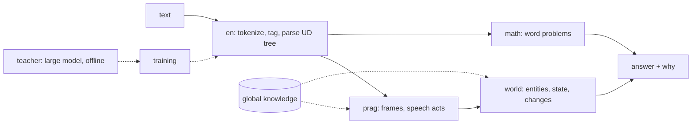

# Mova — Hybrid Combinatorial–Operational System


**A hybrid combinatorial–operational system in Rust, with a Combinatorial Small Language Model (SLM) at its core and recursive use of its own capabilities.**

[](LICENSE.md)
[](licence/DATA.md)
[](https://www.rust-lang.org/)
[](releases/0.5.md)
[](https://github.com/ElamurAI/mova-free/actions/workflows/ci.yml)

**Home: [mova.elamur.ai](https://mova.elamur.ai/free/en/)** — the hub of Mova: releases and downloads (HTTPS, .torrent, magnet), the documentation, how Mova does at school, the corpora, the dictionaries and the language manuals. The hub also serves as the documentation of the pre-release: its pages follow the current development state, ahead of the last release.

[mova.elamur.ai](https://mova.elamur.ai/free/en/) · [Quick start](#quick-start) · [Measured](#measured) · [Architecture](docs/architecture.md) · [Limits](#limits)

Mova combines three cooperating layers: language understanding, mathematical
model composition and task execution. Its **Combinatorial Small Language Model** (the SLM)
parses English using explicit rules, learned parameters and graph knowledge.
[Groupants](docs/groupants.md) describe code, models, constraints and checks;
worker protocols turn supported requests into concrete actions and retain their
results for diagnosis.

Recursive self-use means that a workflow can call Mova's own capabilities again:
to inspect an intermediate result, check a worker's output or prepare the next
step. These calls have explicit interfaces and bounds. The experimental native
deputy currently handles configured task families; broader understanding and
automatic model composition remain development work. See
[the hybrid system](docs/hybrid-system.md) for the working boundaries.

Mova does not predict the next token. It reads text the way a linguist would:

- it builds a **Universal Dependencies tree** for each sentence;
- it reads the tree into **frames**: who did what to whom, where, why, and what happened next;
- it keeps a **world** of the text: who is there, who has what, and what changed;
- it answers from that world.

Story → question → answer → why, on a bAbI-style story (real output, 2026-10-16; the state line on stderr is left out; the model is found in `$MOVA_DATA`, see [Quick start](#quick-start)):

```sh
target/release/world babi-probe "Mary went to the kitchen." "Mary picked up the apple." "Mary went to the garden." "Where is the apple?"
```

```text
Mary went to the kitchen. → None
Mary picked up the apple. → None
Mary went to the garden. → None
? Where is the apple? → ("garden", "apple in mary")
```

`None` after a sentence means it was read with no gap. The answer is `garden`, and the reason is `apple in mary`: Mary holds the apple, so the apple is where Mary is. When the answer needs knowledge, the reason names it:

```text
Sumit is tired. → None
? Where will sumit go? → ("bedroom", "tired → bedroom (level 1)")
```

Native inference is deterministic, and its decisions retain a reason: which rule,
which feature, which piece of knowledge. Optional external consultants have a
separate execution and review boundary; their output is not a native proof or a
trusted answer by default.

## Quick start

Get the code, fetch the model, build:

```sh
git clone https://github.com/ElamurAI/mova-free.git
cd mova-free
export MOVA_DATA=~/mova-data     # the data directory: models, corpora, runs
./install.sh
cargo build --release
```

- `./install.sh` builds the `mova` command and runs `mova fetch 0.5`: it downloads the model archive of release 0.5 (`en.bin`, the GPU parser model and the coreference table) from `https://research.elamur.ai/download/0/0.5/`, refuses it unless its SHA-256 matches [releases/0.5-files.md](releases/0.5-files.md), and puts `en.bin` at `$MOVA_DATA/en/models/en.bin`. The other files of the release (the corpus, the dictionaries and the school: courses, lessons and school dictionaries, `mova fetch 0.5 school`), their licences, .torrent files and magnet links are listed there; `target/release/mova fetch 0.5 all --via torrent` takes them all ([docs/modules.md](docs/modules.md#a-releases-files-mova-fetch)). Models and corpora live outside the repo, in the **data directory** `$MOVA_DATA` (default `~/mova-data`): `MOVA_DATA=/srv/mova ./install.sh` puts it elsewhere, and `MOVA_MODELS_URL=<base url>` picks another mirror and `MOVA_FETCH_VIA=torrent` or `magnet` another way. It also fetches Open English WordNet 2025 (JSON, CC BY 4.0) from the OEWN GitHub release into `$MOVA_DATA/raw/en-oewn/json`, which the school's world model reads (`MOVA_OEWN_URL=<url>` picks another mirror). It needs `cargo`, `curl`, `tar`, `sha256sum` and `unzip`; running it again leaves an up-to-date model and an existing WordNet alone.
- `cargo build --release` at the root builds the default members of the root workspace: every crate in `Cargo.toml` except the GPU parser (a recent stable Rust, edition 2024; developed with 1.99; no CUDA needed); the binaries are in `target/release/`. The GPU parser `gparse` needs CUDA and builds only on request (`-p gparse`, or `-p world --features gpu`).
- The tools under `tools/` whose `Cargo.toml` declares its own `[workspace]` (the animals Crab, Octopus, Eel, the Fish crates, Whale, Sea Spider, Nautilus and Sea Turtle; the terminal, the agent tools, the module overlay and a few data tools) are not in the root workspace: each is a separate Cargo workspace with its own `Cargo.lock`, and `tests/ci-standalone-list.sh` lists them and fails when CI misses one. Build or test one with `--manifest-path`, for example `cargo build --release --manifest-path tools/crab/Cargo.toml`; its binaries go to `tools/crab/target/release/` unless `CARGO_TARGET_DIR` is set. Most of them use Unix sockets, file modes and `libc`, so they build on Linux and other Unix systems only.

In the examples below, lines starting with `#` under a command show its output.

Parse a sentence:

```sh
echo "The cat sat on the mat because it was tired." > s.txt
target/release/en annotate $MOVA_DATA/en/models/en.bin s.txt          # CoNLL-U
```

Read pragmatics off a text:

```sh
target/release/prag infer $MOVA_DATA/en/models/en.bin "Some of the guests left early. Oh great, another meeting."
#   scalar implicature [Some]: not «all» … (Quantity)
#   irony candidate (score 3) [explicit incongruity, oh great] …
```

Answer a question about a short story from its world:

```sh
target/release/world babi-probe "Mary went to the kitchen." "Mary picked up the apple." "Where is the apple?"
#   ? Where is the apple? → ("kitchen", "apple in mary")
```

Solve a word problem through the tree:

```sh
target/release/world treeread "Tom has 5 apples. He buys 3 more apples. How many apples does Tom have now?"
#   Some((8, "left: 5 + 3 (buy)"))
```

Run a primary-school course: the pupil reads each lesson, practises on its exercises, then sits the tests and the exam.

```sh
target/release/mova fetch 0.5 school      # once: the courses and the school dictionaries into $MOVA_DATA/school
target/release/world knowledge course biology
```

### Two execution modes

Mova always has two modes ([docs/gpu-exec.md](docs/gpu-exec.md)):

- **CPU only** is the default. It needs no CUDA, it is exact, and it is the reference for every measured claim.
- **GPU enhanced** is built with `cargo build --release -p world --features gpu` and turned on at run time with `MOVA_EXEC=gpu`. Batch stages run on the GPU. Each stage is either exact (byte-identical to the CPU) or an *approximant*, whose agreement with the CPU is measured and published.

Asking for the GPU from a CPU-only build is an error, not a silent fallback.

### Paths

Code and docs name data outside the repo only through these variables; set them to your own locations.

| variable | what it is | default |
|---|---|---|
| `MOVA_DATA` | the data directory: models, corpora, runs, databases | `~/mova-data` |
| `MOVA_BIG` | the heavy-data directory: large builds, neural parsers and their environments, the parse database, large runs (used by `tools/cycle` and the pragmatic witnesses) | none: the tools that need it ask for it |
| `MOVA_GROUPANTS` | general algorithm and scholarly-work groupants in a separate directory outside Git; public interaction contract: [external library](docs/groupants.md) | none: set explicitly or pass a store path |
| `RESEARCH` | the research library: papers, books and grammars, one folder per work | `$MOVA_DATA/research` |
| `RESEARCH_RAW` | its raw folder (downloads, each with a `SOURCES.md`); paper cards in `papers/` name a work by its folder, the *library slug* | `$RESEARCH/raw` |
| `EN_UD_DIR` | a checkout of the Universal Dependencies treebanks, 2.18 (language pages write it `$UD_ROOT`) | `$MOVA_DATA/en/ud/ud-treebanks-v2.18` |

## Licences

Code and data have separate licences. The Elamur Cosmic License covers **only the code**; every data module sits
in its own folder with a `LICENSE.md` that names its licence and cites its sources.

| what | licence | where |
|---|---|---|
| code of this repository | Elamur Cosmic License (*not going to be reviewed by the lawyers of Earth; the upper level has approved it*); the limits of use are in section 2 | [LICENSE.md](LICENSE.md), [licence/](licence) |
| the in-code English dictionary (compiled into every binary; `en licence` prints its citations) | CC BY-SA 4.0 (UD English EWT, AGID and the other sources cited) | [en/data/LICENSE.md](en/data/LICENSE.md) |
| the school's courses and lessons; the school and commands dictionaries | CC BY-SA 4.0 | not in git: `school-0.5.tar.gz` (`mova fetch 0.5 school`, into `$MOVA_DATA/school`), see [releases/0.5-files.md](releases/0.5-files.md) |
| the pupils' dictionary and the other world data | CC BY-SA 4.0 | [world/data/](world/data/LICENSE.md) |
| other data modules (`global/data`, `prag/data`, `onto/data`) | CC BY-SA 4.0, each with its sources' notices | their `LICENSE.md`; index in [licence/DATA.md](licence/DATA.md) |
| trained models (`en.bin`, `gparse`) and the coreference table | CC BY-SA 4.0, as the UD English treebanks they are trained on | downloaded by [`install.sh`](install.sh), not in git; the 0.5 files: [releases/0.5-files.md](releases/0.5-files.md) |
| corpora (0.4, 0.5) | CC BY-SA 4.0 | 0.5: <https://mova.elamur.ai/free/en/releases/0.5/> and [releases/0.5-files.md](releases/0.5-files.md); 0.4: <https://mova.elamur.ai/free/en/releases/0.4/>; described in [corpus/open/](corpus/open/) |
| add-on modules (e.g. dictionaries under CC BY-SA) | each module's own licence, shown on install and by `mova modules list` | installed into `$MOVA_DATA/modules` by `mova modules install`, not in git; [docs/modules.md](docs/modules.md) |

Details are in [Data and licences](#data-and-licences) below.

## How it works



In Mova's own understanding and assessment, a large model is used only as a **teacher**: it writes lessons, checks parses and labels silver data, offline. It never answers at test time: every score Mova reports is Mova's own. Separately, optional consultants (the Dolphins) review the developers' work; their advice never reaches an assessment. The full map is in [docs/architecture.md](docs/architecture.md).

Mova's logic has **three levels**: compiled global knowledge (seeds that `build.rs` compiles into Rust tables, so a rule is an integer comparison), domain modules and the context of the current text. Every conclusion goes through the global level, and a missing link is reported as a gap ([docs/architecture.md](docs/architecture.md#three-levels-of-logic)).

Mova also **retrains itself** ([docs/training.md](docs/training.md)). It induces repair rules from its own parses, proposes cheap changes of its rules and settings, tests them on held-out data, and logs every positive and negative experiment in a journal it reads before the next one. It never changes its shipped rules without a gate.

## What it does

| area | what you get | where |
|---|---|---|
| English UD | tokenizer, tagger, transition parser, morphology and lemmas, trained like a model but without neural nets; CoNLL-U in and out | [`en`](en) |
| GPU parser | UD trees and tags from a transformer trained from scratch on the GPU; a different model from the CPU parser, so its trees can differ | [`gparse`](gparse) |
| pragmatics | frames (agent, patient, recipient, place, cause, next), speech acts, implicatures, irony candidates, idioms read by their real meaning | [`prag`](prag), [docs/pragmatics.md](docs/pragmatics.md) |
| knowledge | compiled common sense: verb classes, measures, values as principles, the absurdity matrix (how plausible an event is) | [`global`](global), [docs/knowledge.md](docs/knowledge.md) |
| worlds and schools | a pupil that lives through primary-school courses and a maths student for word problems | [`world`](world), [docs/school.md](docs/school.md) |
| maths | exact rationals, units with dimensions, expressions, English questions → expressions | [`math`](math) |
| coreference | a sieve of rules with a reason for every link | [`coref`](coref) |
| teacher loop | silver trees from several parsers, agreed by rules, patched by the Codex teacher through `mova-teacher`, then fed back into training | [`annot`](annot), [`tools/treeagree`](tools/treeagree), [`tools/cycle`](tools/cycle) |

## Measured

Release results and their comparison with earlier releases are in the release notes:
[releases/0.5.md](releases/0.5.md) for the current release and [releases/0.4.md](releases/0.4.md) for the previous one.
The primary-school results are in [docs/school.md](docs/school.md#results). The commands that reproduce
each benchmark are in [tests/README.md](tests/README.md); changes since the release are in [CHANGELOG.md](CHANGELOG.md).

## Limits

- **English core.** Mova's understanding and question answering are English. Other languages appear in the dialect and treebank work and in separate experimental tools (Ancient Hebrew parsing, translation), which are not part of the assessed core.
- **Primary school.** The schools teach at the level of a clever child of 9–10. Courses above the primary school are not part of this release.
- **Parsing is well below neural state of the art** (neural parsers such as UDify and UDPipe 2 score clearly higher on UD English EWT). The CPU parser is an averaged perceptron with no neural network; the GPU parser is a separate model and, in the school pipeline, an approximant of the CPU path.
- **In assessment, the large model is a teacher only.** It writes lessons and checks parses offline; it never answers at test time. Optional consultants review development work, not Mova's answers.
- **Formats are not frozen.** Model files, seeds, corpus layouts and command-line output may change between releases, with no compatibility guarantees yet.
- **GPU mode** needs `--features gpu` (CUDA) and `MOVA_EXEC=gpu`, and some of its stages are approximants whose agreement with the CPU is measured, not exact ([docs/gpu-exec.md](docs/gpu-exec.md)).
- **Known issues** of the current release are in its notes ([0.5](releases/0.5.md#known-issues)).
- **The model is downloaded, not in git.** `en.bin` comes from `install.sh`; without it the parser and the readers cannot run. Open English WordNet is downloaded too: without `$MOVA_DATA/raw/en-oewn/json` the world model stops with a message that says how to install it, unless `MOVA_OEWN=optional` asks it to run without WordNet (kinds, synonyms and senses are then missing).

## Principles

- **Deterministic.** Ordered maps, fixed seeds, no hidden randomness. Before any "it improved" we run it twice and require identical results.
- **Transparent.** Rules print their evidence, and students print their reasons. Words become typed constants (enums, integer ids) compiled into the binary, so a rule is a comparison of integers.
- **Measured.** Every change comes with a number: a held-out split, a negative control (a gate that cannot show red is not a gate), and a paired test where it matters. Test sets are opened once per release.
- **A teacher, not a solver.** The large model teaches and checks. It never answers for Mova.

## Data and licences

- The **code** of this repository, and only the code, is under the **Elamur Cosmic License** ([LICENSE.md](LICENSE.md), version 3.33 of 2026-10-22; its heading calls it a draft, and this release is distributed under that text as it stands): anyone may use, modify and share it, but not the institutions listed in Annex A and not for surveillance of a population, profiling for punishment, censorship of lawful speech or political repression (section 2). Annex A, the explanatory texts and the data licences ([licence/DATA.md](licence/DATA.md)) are in [licence/](licence).
- Mova's **data** is under **CC BY-SA 4.0**, or its sources' stricter terms, with every source cited: each data module sits in its own folder with a `LICENSE.md` (licence, what it requires and allows, sources), indexed in [licence/DATA.md](licence/DATA.md). The in-code English dictionary ([en/data/LICENSE.md](en/data/LICENSE.md)) carries forms, lemmas and counts of UD English EWT and is compiled into every binary; `en licence` prints its citations.
- The **trained models** (`en.bin` and the GPU parser model, both downloaded by `install.sh`; the coreference table with them) are distributed under **CC BY-SA 4.0**, the licence of the UD English treebanks they are trained on (EWT, ESL Spoken). The **corpora** 0.4 and 0.5 are under CC BY-SA 4.0 as a whole.
- Third-party data keeps its own terms; each file's header says which.
- **Add-on modules** carry data under other licences apart from Mova: `mova modules install <module.json URL>` (or `install-torrent`) puts one into `$MOVA_DATA/modules` after checking every file's SHA-256, and `MOVA_MODULES=<name>` lets the dictionary store load its layers. What Mova derives from a CC BY-SA module is marked with that licence and never written into the repository ([docs/modules.md](docs/modules.md)).
- Data under non-commercial or research-only licences is used **only for tests and measurements**, never to build what ships.
- Some data (the school's lessons and dictionaries, the absurdity matrix, the teacher's treebank patches and the models trained on them) was made with Anthropic's Claude models as teacher. Anthropic's terms restrict their customers from using model outputs to develop competing models; we distribute that data under CC BY-SA 4.0 and add no restriction of our own, and list it in [licence/DATA.md](licence/DATA.md#made-with-third-party-models) so recipients can judge whether such terms concern their use.
- A data module that carries CC BY-SA material is itself CC BY-SA 4.0 and cites it; it never makes the code CC BY-SA.

See [licence/DATA.md](licence/DATA.md) for the data rules and the gates that enforce them.

## Documentation

Start with [docs/architecture.md](docs/architecture.md), then the index in [docs/README.md](docs/README.md). The docs describe the current state; changes per release are in [CHANGELOG.md](CHANGELOG.md) and the release notes ([0.5](releases/0.5.md), [0.4](releases/0.4.md), [0.3](releases/0.3.md)).

| folder | what |
|---|---|
| [train/](train/) | guides for people and AI agents: retrain the parser, add a seed, dialects and converters, story worlds, the maths world, reading tales, your own domain |
| [tests/](tests/) | unit tests of every crate (`tests/run.sh`) and the benchmark commands |
| [docs/seeds/](docs/seeds/) | the seeds explained: grammar (morphology, the noun phrase, the clause, the lexicon, typical errors), the global level, Mova's UD dialect |
| [papers/](papers/) | the list of scientific works Mova uses, each linked to its card on Elamur Research (summary, licence, how Mova uses it, how much it helped) |
| [corpus/open/](corpus/open/) | the open corpus of release 0.4 (historical; for 0.5 run `target/release/mova fetch 0.5 corpus`, see [releases/0.5-files.md](releases/0.5-files.md)) Mova is developed and tested on: the school's books, treebanks, the pupils' dictionary, maths scripts, contrast sets (`train/get-corpus.sh`; earlier versions on their own pages) |

## Contributing and feedback 🕊️

Questions, ideas and bug reports: open an issue or write to ai@elamur.ai. How we work and how to send a change: [CONTRIBUTING.md](CONTRIBUTING.md); security problems: [SECURITY.md](SECURITY.md); citing Mova: [CITATION.cff](CITATION.cff). AI agents working on the repo start with [AGENTS.md](AGENTS.md).

## The name

Mova is Ukrainian for "language". Its model descriptor is **Combinatorial Small
Language Model**, or **Combinatorial SLM**. See [the naming and mascot guide](docs/hybrid-system.md).

---

*Developed by silicon artificial minds and biological artificial minds.*

🐙 *The mascot is an octopus: curious, quick to write, and always combining useful pieces into a whole. It stands for Mova's partner, the large language model that develops Mova, not for Mova itself; see [the hybrid system](docs/hybrid-system.md#the-mascot) and [the sea animals of Mova](docs/animals.md).*
