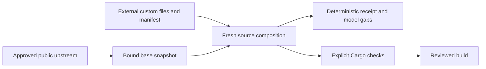

# Animals and workers

This page describes who does the work around Mova. The 🐙 Octopus is a large language model that develops and coordinates Mova from outside. Every other animal is a Rust program on Mova whose understanding of English is Mova's own. The page covers each animal's role and limits, how the animals talk to each other, the rules for what their reports prove, how to add custom modules without editing upstream, and MovaBot, Sea Spider's web robot.

## The Octopus is not Mova

**🐙 The Octopus is a large language model (LLM).** It writes and reviews Mova's code, plans the work, reads the logs and teaches. It gives Crab its tasks as plain English. It is *not* part of Mova's runtime, and it never answers Mova's own tests or assessments for it ([the hybrid system](hybrid-system.md)).

There are two kinds of minds:

- **LLMs** (🐙 Octopus, 🐬 Dolphins, and the teachers that Fish, Whales, Nautilus and Sea Turtle call) bring broad knowledge and judgment from outside. They develop, review and teach.
- **Mova's animals** (🦀 Crab, ⚡ Eel, 🐟 Fish, 🐋 Whales, 🕷️ Sea Spider, 🐚 Nautilus, 🐢 Sea Turtle) are deterministic Rust. They may hold an AI terminal as a tool, but the animal itself is not an AI session.

The goal for every animal of Mova is to understand arbitrary English and to formulate English itself. When an animal does not understand a request, that is not worked around: it becomes a review candidate and teaching material. The command school (`$MOVA_DATA/school/courses/commands`) and Mova's other [schools](school.md) exist to close such gaps.

## The animals

| Animal | Crate | Role | May | May not |
|---|---|---|---|---|
| 🐙 Octopus | — (an LLM) | Developer and coordinator. | Write code, plan, review, assign tasks to Crab in English. | Run inside Mova; answer Mova's assessments. |
| 🦀 Crab | [crab](../tools/crab/README.md); the `crab` binary in [octopus](../tools/octopus/README.md) | The Octopus's single deputy and supervisor. | Understand English prompts with an optional priority; journal every request; start, adopt, restart and stop configured workers; check the GPU before GPU work; feed and unclog worker queues. | Let a new prompt interrupt running work (only an emergency stop does); take a control operation or worker name from a prompt; execute one Dolphin's advice (only a council agreement on an allowed action acts). |
| ⚡ Eel | [eel](../tools/eel/README.md) | The learner. Improves Mova's own models in short GPU rounds; at present the syntax model `gparse`. | Install a candidate that passes the development gates. | Install a candidate that fails them; train pragmatics (not implemented yet). |
| 🐟 Fish | [fish](../tools/fish/README.md), [fish-terminal](../tools/fish-terminal/README.md), [fish-pages](../tools/fish-pages/README.md), [fish-swarm](../tools/fish-swarm/README.md), [fish-priority](../tools/fish-priority/README.md), [fish-batch](../tools/fish-batch/README.md) | Annotation workers for syntax (AST) and pragmatics. | Prepare bounded, source-bound teacher requests; run native agreement checks; publish review envelopes and GPU-admission candidates. | Authorize training; turn their reports into admitted annotations without review. |
| 🐋 Whales | [whale](../tools/whale/README.md) | Giants that write big articles: special missions given by a deployment's own prompt and pinned specification, such as describing a scientific paper in depth. A deployment names and configures its own Whales. | Learn on a source round after round, ask their own terminal only what they did not understand, keep the answers as knowledge; answer English on a private socket. | Start by default; take dictionary or school work; let their terminal write the article. |
| 🕷️ Sea Spider | [seaspider](../tools/seaspider/README.md) | Link downloader; runs [MovaBot](#movabot). | Fetch the URLs it was given, keep raw pages compressed, answer English questions about its work. | Start by default; run twice on one host; ignore `robots.txt`; serve callers outside its configured allowlist. |
| 🐚 Nautilus | [nautilus](../tools/nautilus/README.md) | Dictionary maker. | Grow dictionary layers entry by entry from a course or corpus, natively first (Mova's own lemmas, UPOS, counts and examples); propose review-only improvements; take dictionary jobs from a Crab work pool. | Start by default; ask its teacher without the operator's word; ship a layer that quotes CC BY-SA text. |
| 🐢 Sea Turtle | [turtle](../tools/turtle/README.md) | School maker: questions, lessons and exams. | Check courses with the school's rules; make native questions. | Start by default; ask its teacher for written lessons without the operator's word. |
| 🐬 Dolphins | [crab/dolphins](../tools/crab/dolphins) | A pod of LLMs in terminals: consultants and a documenter. | Review the Octopus's work on request; write documentation on their own branch for review. | Act as authority (advice is evidence only); serve as another animal's terminal. |
| Terminals | [terminal](../tools/terminal/README.md) | One private LLM session per animal instance (`mova-terminal`). | Answer one bounded question at a time into a file. | Be shared between animals; have their answers executed. |

Nautilus and Sea Turtle each run a bounded standing loop: pick an item, read it with Mova, ask its own terminal when unsure, pass the gates, journal. Their proposals stay review-only until admitted ([nautilus](../tools/nautilus/README.md#scope), [turtle](../tools/turtle/README.md#scope)). The commands dictionary layer ships with Mova; a layer that quotes Wikipedia is CC BY-SA 4.0 and never ships.

### What starts by default

Crab starts the Eel, two Fish and the Opus consultant Dolphin. Two Fish are the recommended minimum; a deployment may run more, up to eight. Sea Spider, Whales, Nautiluses and Sea Turtles never start by default: a deployment's configuration or an explicit English request to Crab starts them. Sea Spider and each Dolphin are singletons: one host-wide lock, and a second start reports the running one.

Every animal that needs an LLM holds its own private terminal. The code is shared; the AI session is separate per animal instance. Crab starts a `crab-tmux-worker` that holds the session; the animal asks one bounded question at a time and reads the answer from a file, never executing it.

## Models

Defaults for the animals that call an LLM:

| Animal | Default | Alternatives |
|---|---|---|
| 🐟 Fish | Sonnet | Terra (`gpt-6.1-terra`, through Codex CLI) is recommended; Sol or Haiku selectable. The Codex transports (the `tools/fish` controller and `tools/fish-terminal`) default to Terra and accept any configured `gpt-*` model. |
| 🐋 Whales | Opus | Sol (`gpt-6.1-sol`, Codex CLI). |
| 🐬 Dolphins | Opus (CLI alias `opus`, the latest available Opus) | Sol; a consultant may also be Fable (`claude-fable-5-1`) or Astra (`gpt-6-astra`, Codex CLI). |
| 🐚 Nautilus, 🐢 Sea Turtle, terminals | Opus through Claude Code | Sol through Codex. |

Octopus and Dolphin name responsibilities, not an allowed-model list. Any trusted provider can be configured through a declared terminal readiness and ownership profile. The transport uses an existing terminal; it does not attest or switch the model inside that session. On the wire the consultant session is the key `opus_session` and the operation `consult_opus`; these names do not restrict the model.

The training teacher of Mova's own pipeline (`mova-teacher`) is a separate route: Codex CLI only, default `gpt-6.1-terra` ([training](training.md)). No route falls back to the Claude API or another provider. A deployment pins its models in its own configuration, outside public source, without editing upstream or switching a running session.

## How they talk

### Crab and its deputy planner

The Octopus sends Crab plain English, optionally marked urgent. Crab's understanding is its native deputy planner, the crate [`tools/octopus`](../tools/octopus/README.md) (`mova-octopus`). The planner runs Mova's English annotator and world tree reader on the unmarked prompt, records the real UD nodes and a deterministic question frame, and maps them to a configured capability. Native UD ancestry must connect the request head with an observation. Vocabulary, capabilities, handlers and their parameters are configuration; the prompt only selects one. A prompt the planner cannot understand is an explicit refusal with a review candidate. The `crab` binary of that crate is Crab with this planner installed:

```text
crab serve CRAB_CONFIG DEPUTY_CONFIG [COMMAND_CORPUS]
crab ask SOCKET REQUEST_ID [urgent] < any-text
```

Requests are answered one at a time. Waiting requests are ordered urgent-first, then by arrival; a running request is never interrupted. The planner is a bounded skeleton resolver and does not establish general task understanding. See the crate README for the socket protocol, the installed handlers (`crab_observe`, `crab_control`, `log_tail`, `animal_ask`) and their checks.

### Asking other animals

Sea Spider, the Whales, Nautilus and Sea Turtle take English on their own private sockets. Crab relays: "Ask Sea Spider: «Is the queue empty?»" sends only the quoted English to Sea Spider's socket and returns its English answer. A Whale configured with Sea Spider's socket asks it the same way. The target socket always comes from configuration, never from a prompt. A receiving animal keeps an allowlist of callers and journals who asked; the caller name is a declaration by the owner's process, not authentication. Every request and answer is journaled, and nothing uncertain is replayed automatically.

### The Dolphin pod

Mova ships three standard Dolphins ([tools/crab/dolphins](../tools/crab/dolphins)):

- the **Opus consultant** (Claude through the `claude` CLI, alias `opus`; starts by default);
- the **Copilot consultant** (GitHub Copilot CLI; off by default; starts only while its pinned version, file hash and login check pass, with its shell tool denied);
- the **documenter** (Claude; off by default), which writes documentation on its own branch for the Octopus to review.

Both consultants share the [consultant prompt](../tools/crab/dolphins/consultant.md); the documenter has its [own prompt](../tools/crab/dolphins/documenter.md). A deployment may configure any number of Dolphins, each with its name, aliases, prompt, provider and session, in its own configuration. See [Crab's Dolphins](../tools/crab/README.md#dolphins).

The Octopus talks to Dolphins through Crab, always naming one: "Ask the Opus Dolphin: «…»", "Is the Copilot Dolphin busy?", "Show the Opus Dolphin's answer.", "Start the documenter.", "Which Dolphins are running?". Crab queues the quoted text and hands it over only when that Dolphin is idle; it never overwrites an active task. A bare "the Dolphin" is refused as ambiguous when several exist. Crab may consult a configured Dolphin itself about a request it could not understand or a worker that keeps failing; the answer is kept as a review record and teaching material, never executed.

### Work flow and the council

Crab keeps its continuously running workers fed and unclogged. Configured probes say where each worker's input queue, stacks (pending, quarantine, uncertain, unconsumed output) and progress signal are; Crab reads them every minute with hysteresis.

- A worker out of work: Crab starts its stopped producer.
- A stack overflowing: Crab pauses the producer through its `PAUSE` file, never killing work in flight.
- A worker that stops progressing: restarted only where its policy allows.
- A ChatGPT or Claude limit marker: Crab holds.
- Anything Crab may not fix: the Octopus's attention queue.

Ask: "Do the Fish have work?", "Show the Fish queues.", "Is any worker clogged?", "What needs my attention?".

Every half hour (configurable) Crab's council — two or more named consultant Dolphins — receives the same digest of probe values, recent actions, capacity per animal kind and misunderstood requests. Each answers independently with one typed verdict line. Crab acts only when all name the same allowed action. Disagreement, a request for the Octopus, a malformed verdict and every verdict that there are too few or too many of some animal go to the attention queue; the Octopus decides. Several Nautiluses can form a Crab work pool: Crab leases each idle one a job, and a job's ledger keeps a moved job from asking anything twice. See [work flow](../tools/crab/README.md#work-flow-every-worker-has-work-and-no-stack-clogs), [work pools](../tools/crab/README.md#work-pools) and [the council](../tools/crab/README.md#the-council).

### Durable signals, not a live chat

Crab is an independent process that executes the configured steady-state policy. It does not need an active Octopus chat or approval for every ordinary valid action. While rules are being developed or tuned, the Octopus inspects often; in steady state, work runs on durable signals, checkpoints and exception handling.

- A durable queue survives the absence of a live root session. Review requests are checkpoint artifacts, not synchronous demands for someone to stay online.
- Each task policy states what advances automatically and what decision it awaits. The terminal Fish's explicit review handoff is its own policy, not a rule for every operation.
- Pending semantic, training and code-application decisions never imply approval.
- Crab reserves a request's identity before any effect, binds a duplicate to its payload and preserves uncertain outcomes rather than replaying them.

### Public pieces and deployments

| Crate | Provides |
|---|---|
| [crab](../tools/crab/README.md) | Bounded socket requests, uncertain-request journals, report discovery, source-bound SQLite annotation versions, review exports, disjoint worker supervision, Dolphin adapter, native collection (`native-collect`) and pinned read-only recall (`native-recall`). |
| [octopus](../tools/octopus/README.md) | Crab's native deputy planner and the `crab` binary. |
| [fish](../tools/fish/README.md) | The annotation controller with its prompt and admission guard. |
| [fish-terminal](../tools/fish-terminal/README.md) | The interactive Codex terminal supervisor and argv-only tmux adapter. Each Fish owns a disjoint workdir and session. Identifiers with the `peta-fish` prefix are fixed protocol names, not an actor. |
| [agent-mova](../tools/agent-mova/README.md) | Shared Mova-native capability adapters. Role orchestration calls this common contract instead of duplicating parsing or model logic. |
| [agent-runner](../tools/agent-runner/README.md) | An independent once/watch/status runner with an immutable typed queue, process lease, durable reservations, per-job results and `STOP` checkpoints. |
| `teacher`, `annot`, `prag`, [cycle](../tools/cycle/README.md) | Generic transport, annotation validation, pragmatic schemas, bounded annotation and agreement cycles. |

These standalone workspaces need their own checks; a root build does not test them. Concrete task queues, model selections and deployment configurations are runtime inputs kept outside public source. A source move changes neither running processes nor their pinned executables.

The public Crab server defaults to `NoExternalRoles` and rejects specialized handler calls until an embedding application installs an `ExternalRoleHandler` through `serve_with_roles`. Handlers get server-side configuration after the request, pin and journal gates; clients cannot install handlers or choose role configuration paths. The Whale wire operations are `start_whales` and `whale_status` (role `whales`, configuration keys `whale_config`, `whale_swarm_config`), served by `mova_whale::WhaleRoles`; the `shark` aliases it still accepts are listed in [the Whale README](../tools/whale/README.md#compatibility-identifiers). The dependency always points from a deployment or Whale to public Crab, never the reverse.

## What reports prove

These rules hold for every worker report Crab collects and every parent groupant that summarizes jobs.

### A Fish report is a proposal with provenance

A valid task identity, input digest, nonce and report schema establish *which task produced the report*. They do not establish that its syntax, pragmatics or conclusions are correct. Terminal Fish check task and input hashes, nonce and report identity before publishing a review envelope. An idle terminal does not mean the task is complete or correct.

A correct digest identifies an expected byte observation; it does not show that a separate envelope's fields agree with the decoded report. Hash-only admission would accept a report whose bytes are valid but whose declared task id or outcome is wrong. The native collector therefore also compares schema, id, actor, capability, outcome, source and findings, and admits a report only when all agree. A refusal does not say which field differed.

### Keep the failure kinds apart

Crab keeps task identity, exact input and report bindings, transport state, validation outcome and semantic review outcome separate. A timeout, an uncertain dispatch, a changed input, an invalid report and a reviewed rejection are different failures; they are never merged into one unsuccessful count. A reviewed acceptance keeps its scope: accepting a useful critique is not admitting a corrected annotation.

Groupings must keep the binding category. Native-bound and merely declared records are counted separately, and older summaries without the field read as legacy-unclassified. Counts describe records, not independent witnesses or confidence. Several Fish repeating the same assertion on the same input are not independent sources.

### Context-bound interpretation

A review scope is `(document, source_version, sentence_window, syntax_version, pragmatic_version)`, with the original observations and source anchors kept. Context may constrain a pronoun, a speaker, the scope of a negation or the order of events. It must not silently import the reviewer's background assumptions into the text's world. A masculine pronoun alone does not establish that a referent is human; fiction gives animals the same pronouns. Hearing a sound supports an auditory observation; not seeing its source neither identifies the producer nor proves it absent.

A context consistency check can reject a contradicted reading or leave several compatible readings. Passing it means only that its implemented constraints found no contradiction. It is not a proof of entailment and not a licence to invent a unique missing antecedent. Free-form pragmatic prose is not the typed label schema the annotation pipeline requires.

### Fish preparation boundaries

- Native syntax and pragmatic checks bind source versions, context and witnesses. Refreshing a candidate's hash does not show that its tokens match the source, so the plain-word path also checks character alignment. That is a necessary condition, not proof of correct tokenization or grammar. Multiword and empty-node conventions lie outside that path.
- Pragmatic labels must use the canonical surface. For a six-field label surface `s` with decoder `D` and encoder `E`, preparation admits only `D(s)` existing and `E(D(s)) = s`. A padded value such as ` character ` is rejected rather than rewritten, so source bytes and hashes stay intact and every policy that reads the raw strings sees what the decoder sees. The shared legacy parser stays permissive; this restriction applies to Fish preparation.
- A Fish prepares the teacher argv and a complete request of at most 100000 UTF-8 bytes including wrappers. This bounds the request, not the terminal's history or the provider's context window. Transport components are reusable; the annotation contract and its admission policy define the Fish's remit.
- Evaluation, teacher requests and GPU-admission candidates are separate artifacts. A candidate carries `training_authorized=false`; publishing it does not authorize training, run an adapter or validate a returned model. Full agreement, split, provenance and learning-selection checks stay downstream.

### Observation contracts

The [agent runner](../tools/agent-runner/README.md) separates execution from observation. After its immutable queue is exhausted, a later output-integrity failure can still change the observed state without admitting any new operation. A watch pass therefore emits its initial snapshot, any attempted activity, and any change in the health signature since its last emitted snapshot; unchanged idle polls stay silent. The health signature covers each job's `(id, state, native_outcome, detail)` plus schema, queue identity, `STOP` and admission metadata, but not the attempt count. The first observed `STOP` is emitted before exit.

This is a sampled contract. It misses a change that appears and disappears between polls, does not persist the last snapshot across restarts (a restarted watcher emits a fresh initial snapshot), and never authorizes repair or replay. A silent interval means no qualifying change at the sampled passes, not an unchanged filesystem. A completed scheduler job and a supported native conclusion are separate states. Trace is off by default; an existing checkpoint can feed recall and then native collection without a new learning operation.

### Composition limits

Prepared request, candidate eligibility, native execution, terminal receipt, observed integrity and scientific approval are separate observations. A source-bound producer cannot replace downstream authorization. A watcher log cannot certify missing observations or repair failed evidence. Correct leaves do not prove UI compatibility, whole-system liveness, learning quality or private handler behavior ([groupants](groupants.md)).

A log of a native analysis is retained evidence; a learning claim also needs a changed knowledge or parameter state and checked reuse after a restart ([school](school.md)). Retained episode knowledge is not learned general task execution. A biology gap is a curriculum proposal that needs factual grounding, source evidence and admission; a fictional tale alone does not establish a biological fact.

Local fixtures exercise real control, store and supervisor code, but they do not call a model, migrate a live job or approve a deployment. Frozen jobs, database state, sessions and binary pins need a separate reviewed migration.

## Custom modules without editing upstream

Keep upstream Mova, your customization package and each composed build tree in separate directories. An upgrade replaces upstream; a rebuild applies your reviewed files to a fresh copy. You keep no patch stack inside upstream and merge nothing by hand.

Two kinds of customization fit:

- **Configuration-only pipelines** select operations a public runner already implements. Change an external queue, configuration or plan; the accepted schema decides which operations exist.
- **Replacement or extension modules** change behavior configuration cannot express. Supply your own Rust file or crate, compose it into a fresh tree, and compile and test that tree.

The public [module-overlay tool](../tools/module-overlay/) does the composition. Its input is an approved public source export or checkout; composition does not replace rights, secret or public-export checks.



### Manifest

Create a base snapshot outside upstream:

```text
mova-module-overlay snapshot PUBLIC_SOURCE release-label CUSTOM_ROOT/base.json
```

The label is provenance you supply, not an authenticated Git revision. Each file's SHA-256, byte length and executable bit, and the sorted tree digest, bind the actual input. An external `manifest.json` lists the files (the shipped example has usable hashes):

```json
{
  "schema": 1,
  "base_snapshot": "base.json",
  "base_snapshot_sha256": "SHA256_OF_THE_EXACT_BASE_JSON_BYTES",
  "files": [
    {
      "action": "replace",
      "target": "some/component.rs",
      "source": "modules/component.rs.txt",
      "sha256": "SHA256_OF_CUSTOM_FILE_BYTES",
      "expected_upstream_sha256": "SHA256_OF_REPLACED_UPSTREAM_FILE",
      "executable": false
    },
    {
      "action": "add",
      "target": "pipelines/local.json",
      "source": "pipelines/local.json",
      "sha256": "SHA256_OF_CUSTOM_PIPELINE_BYTES",
      "expected_upstream_sha256": null,
      "executable": false
    }
  ],
  "cargo_manifests": ["path/to/Cargo.toml"]
}
```

Rules:

- Paths are canonical and relative. A replacement needs an existing target and its exact base hash; an addition needs an absent target and no base hash.
- Duplicate targets, file/directory collisions, traversal, absolute paths, control characters, reserved namespaces, unknown fields, hooks and shell strings fail. Entry order never decides a winner.
- Only listed custom files are copied; every other permitted upstream file is copied with a fresh inode. Executable bits normalize to 0755 or 0644; empty directories and other permission bits are not part of the contract.
- `target`, `.git`, `.env`, `local.md` and earlier receipts are skipped at every depth (even `src/target/mod.rs`). A `peta` subtree is refused. These named exclusions do not classify private material under other names.
- Symlinks, symlinked roots or ancestors, sockets and special files are refused. Output must be fresh, outside both inputs, under an existing physical parent.
- Bounds: 100,000 regular files, 200,000 discovered entries, depth 64, 64 MiB per file, 2 GiB per tree, 1,024 custom entries and Cargo recipes. Inputs must stay stable during a pass; rechecks are not an atomic snapshot or a lock.

### Pipelines and extensions

A pipeline is data interpreted by an implementation; copying a plan into the tree does not make its role names executable. A separate extension crate can implement `ExternalRoleHandler` and supply it to Crab through `serve_with_roles`, leaving the core unchanged. For existing native operations, use the [agent runner](../tools/agent-runner/README.md) and its `example NEW_DIR` schema; an overlay can install its configuration files but does not run it or invent job types. An extension can be its own Cargo crate depending by path on the public crates in the composed tree.

The shipped Whale example illustrates an "explain this algorithm and review its model" plan: a Whale extension reads the permitted bibliography and writes source-grounded notes, then an explanation with citations; a reviewer checks attribution, assumptions, models and gaps; the Octopus accepts or records why not. The example only returns these planning steps and its JSON is marked as not runner configuration. Real source reading, writing, plagiarism checks, permissions and scheduling belong to a separately implemented extension.

### Upgrades

Check against the new upstream first, and stage only after it passes:

```text
mova-module-overlay check PUBLIC_SOURCE CUSTOM_ROOT manifest.json
mova-module-overlay stage PUBLIC_SOURCE CUSTOM_ROOT manifest.json NEW_TREE
```

The manifest path is relative to `CUSTOM_ROOT`; `NEW_TREE` must not exist. Any changed, added, removed or mode-changed base file — even outside the replacement targets — produces a drift row and blocks staging with the old base. This matters even when the output would look the same: if upstream changes a file you replace, your replacement still wins, but the gate refuses until you review the new original. Then create a new base snapshot, update the replacement base hashes, stage and run the Cargo checks. A hash update does not show that an old module fits a new interface. Equal source maps do not mean equal receipts: the receipt records the base, manifest binding and original-content digests.

The receipt separates missing source groupants, stale source hashes, invalid bindings and matching hashes whose models are unverified; it never refreshes an inherited groupant to make a replacement look modeled. Run the model and registry guards and the relevant native tests on the composed tree. The composer emits check and build argv but does not run them; Cargo may run build scripts, so build only source you chose deliberately. Staging changes no live source, service, training pipeline or deployment.

## MovaBot

MovaBot is Mova's web robot, run by 🕷️ Sea Spider ([tools/seaspider](../tools/seaspider/README.md)). It fetches the pages it was given, stores them compressed for reading and language study, and journals every request.

**Identification**

- User-Agent: `MovaBot/<version> (+https://mova.elamur.ai/free/en/docs/repo-docs/animals/)`
- robots.txt token: `MovaBot`

**Behaviour**

- **robots.txt first.** Before any page of a site it reads that site's `robots.txt` and follows RFC 9309: the `MovaBot` group if present, otherwise `*`; the longest matching rule wins, and `Allow` wins a tie; `*` and `$` patterns work. A 4xx `robots.txt` means everything is allowed; a server error, a 429 or a network failure closes the site for a while.
- **Slowly.** At most one request every 2 seconds per IP address, shared by all sites on that address, and never faster than a site's `Crawl-delay`. One Sea Spider runs per host with one fetch stream, so the limit is never split across parallel crawlers.
- **Only what it was given.** It downloads the links in its queue. Its operators fill the queue in plain English, and it takes only the URLs the request names; a question such as "Are we allowed to fetch …?" never fetches a page. Following links is off by default; when on, it stays on the same site with depth and page limits.
- **Every redirect is checked again** against the target's `robots.txt` and the per-IP limit.
- **No cookies, no JavaScript, no forms, no logins.** Bodies are capped in size and requests time out.

**How to block it.** Add to your site's `robots.txt`:

```
User-agent: MovaBot
Disallow: /
```

**Contact.** Write to ai@elamur.ai with the site and, if you can, the time of the requests; we will look into it.
